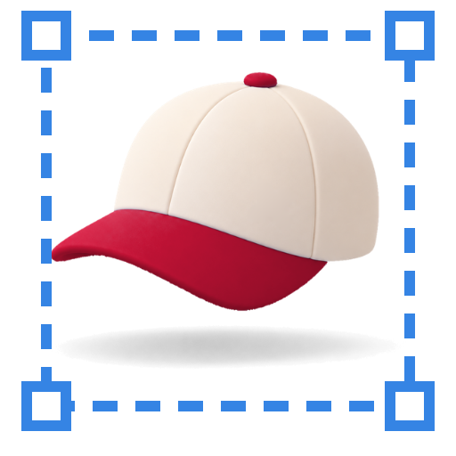

<p align="center"></p>

# CapIt

**ShareX-style screenshots, annotation, GIF and video recording for GNOME.**

Press the keybind and the desktop freezes. Point at a window, or at a sidebar,
a toolbar or a line of text inside it, and CapIt offers it as a box: click to
take it, scroll to widen it, or drag your own region across monitors. Draw
arrows, boxes and text, or blur and redact, right there on the screen, then
press Enter to copy and save. A second keybind records a region the same way,
as a GIF or an MP4.

CapIt is built to be fast and intuitive. It runs inside GNOME Shell, so the
screen freezes the moment you press the keybind, with no permission prompt, and
every tool shows its key on its button. It's a GNOME Shell extension for
GNOME 45 to 50, on Wayland and on Xorg.

## Features

- **A frozen screen** across all monitors, so menus and tooltips stay where
  they are while you pick.
- **Smart boxes** for whole windows, and for the panels, rows, words and
  pictures inside them, found in the image itself or from the applications'
  accessibility tree.
- **Annotation in place:** arrows, rectangles, circles, freehand, text, blur
  and solid redaction, with colours, undo and redo. Each tool's key is shown on
  its button.
- **Copy, save or both.** By default the clipboard gets the saved file, which
  chat apps and browsers paste as an attachment, and GIFs stay animated.
- **GIF and MP4 recording** of a region, with a stop bar, a time limit for GIFs
  and a demo cursor that shows the pointer and its clicks.
- **Nothing leaves your computer.** No network, no telemetry, and redaction
  replaces the pixels instead of covering them; see [SECURITY.md](SECURITY.md).

## Install

CapIt is in beta. Ubuntu 24.04 and 26.04 get packages; on other distributions
with GNOME 45 to 50, install the extension zip.

**Ubuntu, from the PPA** (recommended). Updates arrive with the system's other
updates, and the package brings FFmpeg and the GStreamer plugins recording
needs:

```sh
sudo add-apt-repository ppa:karazum-capit/stable
sudo apt install gnome-shell-extension-capit
```

**Ubuntu, a `.deb` from [Releases](https://github.com/karazum/capit/releases).**
Download the one for your Ubuntu release, check it against `SHA256SUMS`, and
install it:

```sh
sudo apt install ./gnome-shell-extension-capit_*~24.04_all.deb
```

**Other distributions, the extension zip** from
[Releases](https://github.com/karazum/capit/releases):

```sh
gnome-extensions install capit-*.shell-extension.zip
```

Recording also needs FFmpeg from your distribution. GStreamer's x264 plugin,
`gstreamer1.0-plugins-ugly` on Ubuntu, keeps the temporary recording small;
without it, recording works but takes much more disk space.

**extensions.gnome.org:** not yet. CapIt goes there with version 1.0.

**From source:**

```sh
git clone https://github.com/karazum/capit.git
cd capit
make install
```

**Then** log out and back in, since GNOME on Wayland finds a newly installed
extension only at login, and turn CapIt on in the Extensions app or with:

```sh
gnome-extensions enable capit@karazum.github.io
```

The cap appears in the top bar. If something is missing, `capit doctor` says
what, and the preferences window shows the same.

## Using CapIt

[Using CapIt](docs/usage.md) has the keyboard and mouse controls, how smart
boxes find elements, the recording and clipboard settings, the `capit` command
and the timing log.

## How it compares

Other screenshot tools do some of this, and several do things CapIt doesn't.
This is how they look on GNOME, from each project's documentation and source in
November 2026: Flameshot 15.0, Spectacle 6.8, Gradia 1.14 and EShot 4.9.

| | CapIt | [Flameshot](https://flameshot.org) | [Spectacle](https://apps.kde.org/spectacle/) | [Gradia](https://github.com/AlexanderVanhee/Gradia) | [EShot](https://github.com/Benoks/EShot) |
| --- | --- | --- | --- | --- | --- |
| What it is | GNOME Shell extension | Qt app | KDE app | GTK 4 app | Qt app |
| Runs on | GNOME 45–50 | Linux, Windows, macOS | KDE Plasma | Linux | Linux, Windows |
| Capture on GNOME Wayland | Inside the Shell, no portal | Through the portal; called experimental | No, it needs KWin | GNOME's own screenshot tool, through the portal | Through the portal |
| Picks windows and elements | Windows, and panels, rows, words and pictures inside them | No | Windows | GNOME's window mode | Not on GNOME |
| Annotation | On the screen | On the screen | Yes | In its editor window | On the screen |
| Hiding parts | Blur, solid redaction | Pixelate, filled box | Blur, pixelate | Pixelate | Blur, pixelate |
| Numbered markers | No | Yes | Yes | Yes | Yes |
| Recording | GIF, MP4 | No | Not on GNOME | No | GIF, MP4, with sound |
| Upload, OCR | No | Upload | OCR | Upload, OCR | Upload, OCR |

In short: CapIt is for GNOME users who want to pick a window or a part of one
in a single motion, mark it up on the spot and paste it, and to record a region
in the same way, with nothing leaving the computer. Flameshot runs on every
desktop and has numbered markers and uploads. Gradia makes a screenshot
presentable with backgrounds, padding and shadows. Spectacle is the choice on
KDE. EShot adds OCR, uploads and sound in recordings.

## Status

CapIt is a beta. It has been tested in a real session on Ubuntu 24.04 with
GNOME 46 on Wayland. GNOME 45 to 50 on Wayland, and 45 to 48 on Xorg, pass the automated
test suite in headless sessions
([Wayland](docs/test-results/2026-11-26-gnome-45-50-headless.md),
[Xorg](docs/test-results/2026-11-26-gnome-xorg-headless.md)), but have not been
used in real logins yet. The [roadmap](docs/roadmap.md) lists what stands
between this and 1.0, and what comes after, such as uploads, capture history
and sound in recordings.

Bug reports are welcome; the issue form asks for the output of `capit doctor`.

## Contributing

See [CONTRIBUTING.md](CONTRIBUTING.md) for the development setup, the tests,
building packages and the policy on AI-assisted contributions, and the
[architecture](docs/architecture.md) for how CapIt fits together.

## License

CapIt is free software under the [GNU General Public License, version 3 or
any later version](LICENSE) (`GPL-3.0-or-later`). Every source file carries an
`SPDX-License-Identifier` line saying so.

It runs inside GNOME Shell and starts other programs, none of which is shipped
with it:

| Dependency | Used for | Licence |
| --- | --- | --- |
| GNOME Shell, which the extension runs inside | Everything | GPL-2.0-or-later |
| GJS | Running the extension | MIT or LGPL-2.0-or-later |
| GTK 4, libadwaita | Preferences window | LGPL-2.1-or-later |
| util-linux's `setpriv` | Stopping FFmpeg when a recording is cancelled while it encodes | GPL-2.0-or-later |
| AT-SPI | Accessibility-tree detection | LGPL-2.1-or-later |
| GStreamer and its PipeWire, base, good and ugly plugins | GNOME's screen recorder, which CapIt asks to record | LGPL-2.1-or-later; the x264 encoder is GPL-2.0-or-later |
| FFmpeg, as packaged by Ubuntu | GIF and MP4 encoding, run as a separate program | GPL, because it is built with GPL parts such as x264; FFmpeg alone is LGPL-2.1-or-later |
| Node.js | Unit tests only | MIT |

Each of these is compatible with `GPL-3.0-or-later` as used here.
