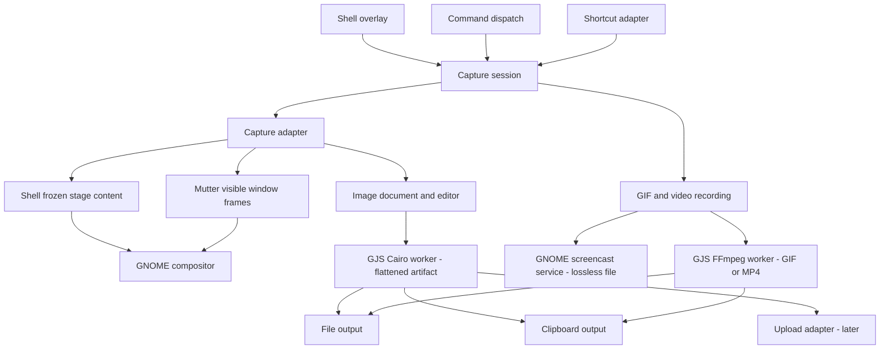

# Architecture

CapIt is a GNOME Shell extension for GNOME 45 to 50, on Wayland and Xorg. The
behavior it implements is described in [product](product.md#capture-behavior);
what has been tested where is in [compatibility](compatibility.md).

## Interaction contract

After clicking a smart box or dragging a rectangle, the selected region remains
movable and resizable while annotation tools appear. Mouse release does not
export or close the overlay. Enter copies the final image and saves PNG; Copy-only
and Save actions are available separately.

The `quick-capture` setting, off by default, skips that step for screenshots:
picking a region by a smart box, a large region's tab or a drag copies and saves
it as Enter would. The toolbar and mode buttons stay hidden during that export
and appear only if it fails, for a retry; moving the region then does not export
again. Recording modes are unaffected, and the mode buttons, shown only beside a
chosen region, cannot be reached, so recordings start from the recording
shortcut.

While a text annotation has keyboard focus, Enter commits that text and leaves
the capture open; a later Enter finishes. Ctrl+Enter commits and finishes together.

Flatten one final document revision into an immutable image artifact. Requested
clipboard and file outputs consume that same artifact and return separate results.
If one fails, retain the frozen image, edits, and artifact for retry, preserve the
successful output, and show which action needs attention. Retry of an unchanged
artifact runs only failed outputs. Resuming editing produces a new revision;
previous output results remain associated with their old revision.

Before export, cancellation produces no output. After partial success, cancelling
recovery cannot remove a saved file or undo an existing clipboard copy. Avoid an
all-or-nothing output transaction that discards successful work.

## GNOME extension integration

[Compatibility](compatibility.md#why-a-shell-extension) explains why CapIt is
an extension rather than a portal client.

The extension captures the stage into frozen Clutter content before adding its
overlay, acquires a modal input grab, and snapshots visible window frame bounds
in stacking order. One stage-wide selection naturally crosses logical monitor
boundaries. On finish, Shell crops the frozen texture into a temporary PNG, then
a `gjs` worker, `renderer.js`, flattens annotations and saves the artifact. Shell publishes the
same final PNG to its native clipboard. There is no separate editor window,
clipboard daemon, or portal capture picker in the normal screenshot workflow.

Disable, monitor changes, and cancellation release the modal grab and destroy
owned actors. Asynchronous capture completion is guarded against reopening UI
after disable. A test-only control interface is exported only inside explicitly
configured isolated test sessions; the normal interface can open capture UI or
report status and does not silently export the screen.

## Implementation stack and future candidates

| Concern | Choice / candidate | Reason / decision gate |
| --- | --- | --- |
| Extension and image document | GJS with a pure JavaScript document module | Native Shell integration; document logic is headlessly testable |
| Capture/overlay/window geometry | Shell, Mutter, Clutter, St | Frozen stage, modal input, window frames, stage-wide selection |
| Image rendering and saving | `renderer.js`, a GJS / Cairo worker process | Render and write PNG outside Shell's JavaScript UI thread, drawing annotations with the same `paint.js` as the live preview |
| Clipboard | St.Clipboard | A file reference or the capture's data, as configured; owned by Shell after overlay closure |
| Preferences | GSettings with GTK 4 / libadwaita preferences | Shortcut and output-folder settings |
| Local history, after MVP | SQLite candidate | History browser is deferred |
| Uploads, later | HTTP client behind an uploader interface | Providers do not affect capture/editor code |
| Credentials, later | Desktop Secret Service integration | Keep tokens out of settings and logs |
| GIF and video recording | GNOME's screencast service (Mutter ScreenCast → PipeWire → GStreamer) for a lossless intermediate; FFmpeg, run by `encoder.js`, a GJS worker process | Same recorder GNOME uses; FFmpeg makes palette GIFs and H.264 MP4s that browsers play |
| Audio and effects, later | Not designed | Audio capture and mixing need separate investigation |
| Distribution | Native Shell extension installation; companion packaging later | A Flatpak cannot install the host extension by itself |

GJS and Cairo come with GNOME Shell, and the worker processes run under GJS too;
Node is used only for development tests. Exact Shell interfaces and primary references are recorded
in [GNOME interface notes](research/gnome-extension-interfaces.md).

## Boundaries

`capit.js` is the Shell adapter: the panel menu, shortcuts, the D-Bus API and
the lifecycle of captures and recordings. `overlay.js` is the capture overlay,
its input handling and its export; `detection.js` runs element detection for
it; `widgets.js` holds the glyphs, buttons and paint patches the overlay and
`recordingbar.js` are built from. `model.js` owns pure selection, annotation,
and undo/redo state, and `renderer.js`, run as `gjs -m`, consumes a finite JSON
request over stdin. `paint.js` draws annotations for both the live
preview and the export. The worker has no desktop access. It returns an artifact path and
independent save result; Shell handles clipboard publication and recovery.
`extension.js` is only the entry point Shell loads. It imports `capit.js` on
enable, and from a fresh copy when the installed extension is a symlink to a
checkout, so a development session picks up edits on disable/enable even
though Shell otherwise keeps an extension's modules until logout.
`testing.js`, which the headless harness drives through a D-Bus interface, is
imported only when `CAPIT_TEST_MODE=1` and is not part of the package.

## Capture contract

A capture request describes intent, such as interactive capture or a preferred
target. The adapter resolves that intent against detected capabilities and
returns an image artifact plus available source metadata, a cancellation, or an
actionable error. It must not report a successful region/window capture if the
backend could not honor that target.

Capture and window metadata are tied to the frozen session; the UI never recaptures the live desktop
on mouse release. Temporary files live in an owned per-capture runtime directory.
Only the selected crop is written to PNG for the worker; the full frozen desktop
remains a Shell texture until the capture closes.

Panel smart boxes come from a detector process, `detector.js`, run as
`gjs -m detector.js --mode visual` or `--mode regions`. It needs no libraries
beyond GJS. Once the overlay has drawn its first frame, Shell encodes each visible window's part of
the frozen texture to PNG in memory, topmost window first, and streams it to the
worker's stdin; no window image touches the disk. The worker splits each window
along straight dividers (borders and background changes that run across nearly
a whole panel), with the algorithm in `visual.js`, and answers with one line of nested panel rectangles per window.
Hovering offers the smallest panel under the pointer, and scrolling steps out to
enclosing panels up to the whole window. Until a window's answer arrives, its smart
box is the whole window. Closing the capture kills the worker.

With `--mode regions`, which the `visual` value of the `element-detection`
setting runs, the same worker also runs `regions.js` on each window. It labels connected areas of flat colour, with
every colour change as a wall between them, and keeps each area that is shaped
like a rectangle: most of the lines across it start and end at the same
position, so a tab that shares its background or a child that overlaps an edge
does not matter. Inside each area it keeps the islands the background flows
around that have a solid, straight outline, such as a card made of rows or a
picture; a word or an icon has neither. The smaller marks left on an area, its
text and icons, are grouped into lines: each line is a row across the area, and
each word, label or icon on it an item of its own. Marks inside cards and
pictures, and slivers along an area's edge from something across it, are left
out, so a picture stays whole. Two areas of one colour with only a
thin band between them, such as an editor above and below its current-line
highlight, count as one area. The pieces between dividers join these
rectangles, here only for dividers that meet another border at one end, which
separators drawn inside a panel do not. Rectangles are then kept largest first,
dropping any that straddles a kept one, so those around a point nest. Rows and
items are kept after every panel, so where a line of text runs on into the next
column, the row is the one dropped. A hover offers the smallest box around the
pointer, such as a line, and scrolling widens it to the panel.

The boxes both detectors find on the reference images in `tests/fixtures/` are
kept in `tests/fixtures/golden/detection.json`, and the GJS tests check that
they still find exactly those. The tests also check what each mode must find in
those windows. After a deliberate change to the regions detector's boxes,
`gjs -m tests/gjs/record-regions.js` records them in the reference file again.

`tests/elements-corpus` records real application windows from a headless
session, as the bytes Shell streams to the worker, and scores both detectors
against curated panels and hover points; see its README before changing either
detector.

The `element-detection` setting chooses the regions worker (`visual`), none, or
`accessibility.js`, run as `gjs -m`, which asks applications over AT-SPI instead. Shell gives it
each window's process ID, title and client rectangle; for each new pointer
position it finds the element at that point in the matching application's frame
and returns it with its ancestors. Shell keeps one question in flight, and the
answers add to the same panel boxes. AT-SPI calls run in that worker, never in
Shell, so an unresponsive application cannot block the compositor. Chromium and
Electron expose their trees only when started with
`--force-renderer-accessibility`; in an isolated session neither
`org.a11y.Status.ScreenReaderEnabled` (which also enables GNOME's screen
reader, persistently), registered AT-SPI event listeners, nor
`ACCESSIBILITY_ENABLED=1` made Edge expose one.

## Workflow and document model

Use explicit states: idle → acquiring → selecting → editing → exporting → running
outputs → complete/recovery. Text entry is a focus state within editing. Retry
does not restart capture; cancellation during recovery does not roll back completed
outputs. Serialize capture requests so repeated triggers do not open overlapping
sessions or permission dialogs.

The document stores crop bounds and editable annotation operations in stage
logical coordinates anchored to the frozen source. The snapshot's measured scale
maps those coordinates to image pixels at export. Preview and export share tool
semantics; redaction expands to cover every touched output pixel without blending
sensitive source pixels at fractional edges.
Undo/redo operates on document changes, and export flattens the final revision
before any configured output receives it.

Selection movement/cropping changes which source pixels are exported; it must
not silently move a redaction away from the information it hides.

Shell's snapshot is one bitmap of the whole stage at the scale Shell reports
for it. Pointer positions are stage logical coordinates, and the export crops
the bitmap on its own pixel grid at that scale, clamping rounded crops to the
texture's bounds. Physical mixed-scale layouts still need validation.

Use opaque redaction for information that must be hidden. Blur is a visual
effect, not a redaction guarantee.
Do not retain originals or editing documents in durable history by default;
clean temporary originals after completion/cancellation. Crash cleanup beyond
the session runtime directory's lifetime remains a release validation item.

## Files and process lifetime

- Shortcut/output settings live in `org.gnome.shell.extensions.capit` GSettings.
- There is no history database in the first release.
- Temporary images use app-specific runtime/cache locations.
- Final captures go to the user-configured directory, initially derived from
  the desktop Pictures directory with a `CapIt` subfolder and a documented
  home-Pictures fallback.
- Use atomic writes where feasible and collision-safe filenames. Record output
  success only after the operation completes, and keep failures visible for retry.
  An unchanged successful save is not repeated while retrying another output.
- Keep full-screen originals out of durable storage after capture is complete or
  cancelled; retain data required for active editing, recovery, and clipboard
  ownership only. Image contents do not belong in logs.
- Shell owns PNG clipboard bytes after the overlay closes. The extension has a
  panel menu, shortcut, and preferences; it does not require a tray icon or a
  resident companion application. Disable through GNOME Extensions.

## Recording

The capture overlay has three modes: `image` (a screenshot), `gif` and `video`.
A column of mode buttons stands beside the selected region. It sits left of the
region when the region's monitor has room there, else right of it, else just
inside the region's left edge (`sideOfRect` in `model.js`). The overlay keeps the
same selection across modes. A recording mode shows only the demo cursor toggle, Cancel and Record
in the toolbar, selects the move tool, and hides the annotations without removing them
from the document. Enter, or a click on the chosen area, in a recording mode closes the
overlay and records that area; a drag still moves it. The record shortcut opens the overlay in the mode of the last recording
started.

`recording.js` waits for a stage frame painted without the overlay, then asks
GNOME's screencast service (`org.gnome.Shell.Screencast.ScreencastArea`) to record
the area. That service is the recorder behind GNOME's own screen recording. It
asks Mutter for a ScreenCast stream of the area, with the pointer drawn in, and
runs a GStreamer pipeline from PipeWire into a file. CapIt passes its own
pipeline: lossless x264 (Y444, quantizer 0, ultrafast) in Matroska, or PNG frames
in QuickTime when x264enc is not installed. The service caps the stream at the
GIF or video frame rate and timestamps frames as they arrive.

With the demo cursor on, `cursor.js` adds a halo actor that follows the pointer
and a ripple actor for each button press to Shell's UI group. Clicks on client
windows never reach Shell on Wayland, so it polls the pointer at about 60 Hz. It
starts before the screencast and ends when the recording stops. The area stream
paints the stage, so the recording includes these actors; the integration run
checks the halo's colour in the GIF.

A red frame drawn just outside the area marks the recording. A recording bar
with the elapsed time, the demo cursor toggle and Stop stands below, above,
right or left of the area, whichever first fits on the area's monitor
(`outsideRect` in `model.js`), so it is never recorded. It is Shell chrome, which
takes clicks over application windows; with no room on any side it is not
shown. The panel icon
shows the elapsed time, and its menu stops or cancels. Pressing the record
shortcut again also stops. The configured duration limit, a monitor change and
the service's `Error` signal end a recording early. Disable cancels it. One
recording runs at a time; an overlay opened during one offers only screenshots.

On stop, `encoder.js`, run as `gjs -m`, makes the file with FFmpeg:

- **GIF:** `palettegen` makes one palette for the whole recording, then
  `paletteuse` maps every frame to it with the configured dithering. The two
  run as separate passes over the recording, so FFmpeg does not hold all decoded
  frames in memory while it builds the palette.
- **Video:** libx264 with the configured preset and CRF at a constant frame
  rate. `yuv420p` makes the file play in browsers, and `+faststart` puts the
  index first so playback can start before a download ends. `yuv420p` needs even
  sizes, so an odd width or height loses its last pixel column or row. Cropping
  happens here rather than in the recorder because GNOME's service cannot be
  given an even-sized area at fractional scales.

FFmpeg is started through `setpriv --pdeathsig KILL`, so cancelling a
recording, which kills the worker, also stops FFmpeg.

The file is published into the output folder by the same code that saves PNGs,
in `worker.js`: it is copied whole to a hidden file, then renamed onto a name
reserved by creating it, so an existing capture is never overwritten. When it is only copied, it goes in `~/.cache/capit/clipboard`, and
only the newest such file is kept.

Copy only always offers the capture's data. For copy and save, the
`clipboard-content` setting chooses, for screenshots and recordings alike. `file`
(the default) offers `text/uri-list` naming the saved file, or a copy kept in
`~/.cache/capit/clipboard` when saving failed. That is
the type applications accepting pasted files read, and a GIF keeps its animation.
`content` offers the data as `image/png`, `image/gif` or `video/mp4`. Shell holds
that data in memory while it is on the clipboard, so files over 100 MB fall back
to a file reference. GJS cannot implement the callback-taking `read_async` of a
Mutter selection source, so an extension cannot offer both at once. Only GTK
clients reading these have been tested.

The service tracks recorders by D-Bus sender. CapIt calls it over Shell's own
connection, so a recording made from GNOME's screenshot UI and a CapIt
recording exclude each other; the second one reports that GNOME is already
recording. Intermediate files live in `~/.cache/capit/recording-*`, not the
memory-backed runtime directory, because PNG frames are large. Every path
removes them, except a recording that failed to encode. That one is kept and
its path reported.

## Future sharing and recording

An uploader consumes the final artifact and returns a validated result URL.
Configure uploads explicitly; never enable a network destination by default.
Store secrets through the desktop keyring and surface unavailable keyring state.
Provider errors preserve the local file. Retry only where the operation is safe;
avoid creating duplicate remote uploads after ambiguous timeouts.

Audio needs separate investigation; the screencast stream CapIt records
carries video only.

## Validation strategy

`make check lint test` validates JavaScript syntax and style, GSettings schemas,
pure document behavior, actual Cairo redaction pixels, save recovery, concurrent
file-name collisions, element detection against reference windows, and GIF and
MP4 encoding. CI runs these on every push.

The [GNOME integration harness](../tests/gnome-integration/README.md) runs the
installed extension in a private headless GNOME Shell: on Wayland on GNOME 45
to 50, and on Xorg on 45 to 48, through containers. It drives a virtual pointer and keyboard and
reads the clipboard from a separate GTK client. It does not touch the desktop it
runs from.

A headless session cannot establish physical-desktop support: real logins are
still needed for shortcuts, clipboard use by real applications, and mixed-scale
monitors. Record those runs separately; see the
[manual test template](compatibility.md#manual-test-record-template).
